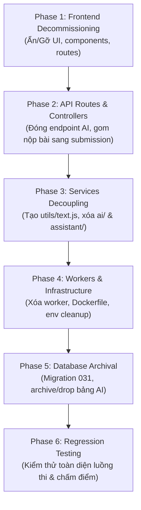

# Kế hoạch & Tiến độ Bóc tách Loại bỏ Tính năng AI (AI Decommissioning Roadmap)

> **Dự án**: IELTSZone  
> **Tài liệu**: Kế hoạch thực thi và theo dõi tiến độ gỡ bỏ tính năng AI  
> **Vị trí lưu trữ**: `docs/ai-decommissioning-plan.md`  
> **Ngày cập nhật**: 22/10/2026  
> **Trạng thái tổng thể**: **Phase 2 (Phase 1 Frontend đã hoàn thành - Sẵn sàng thực hiện Phase 2)**  

---

## 1. Mục tiêu tổng quan

Chuyển đổi toàn diện hệ thống IELTSZone sang mô hình chấm bài và tương tác 100% người thật (Tutor/Giáo viên), loại bỏ hoàn toàn các dịch vụ phụ thuộc vào mô hình AI bên thứ ba (Google Gemini, OpenAI).

Các tiêu chí cần đạt:
1. **Giao diện (Frontend)**: Học viên và Giáo viên không còn thấy bất kỳ nút bấm, modal, quota AI hay màn hình gợi ý AI nào.
2. **API & Controller (Backend)**: Đóng và gỡ bỏ toàn bộ endpoint liên quan AI, bảo đảm client không thể kích hoạt request AI.
3. **Core Services**: Bóc tách triệt để logic AI khỏi luồng nộp bài và chấm bài của Tutor.
4. **Hạ tầng (Worker & Docker)**: Gỡ bỏ worker nền, worker queue, các biến môi trường và thư viện không cần thiết.
5. **Cơ sở dữ liệu (Database)**: Lưu trữ/dọn dẹp an toàn các bảng AI dữ liệu cũ mà không ảnh hưởng tới bảng `users`, `submissions`, `test_attempts`.
6. **Đảm bảo tính toàn vẹn**: Ứng dụng build thành công, backend khởi động bình thường, toàn bộ luồng làm bài và Tutor chấm bài chạy thông suốt.

---

## 2. Báo cáo đánh giá trạng thái hiện tại (Current Status Assessment)

Sau khi quét toàn bộ mã nguồn tại thời điểm hiện tại:

| Thành phần kiểm tra | Kết quả kiểm tra thực tế | Trạng thái |
| :--- | :--- | :---: |
| **Phase 1: Frontend UI & Routes** | Đã xóa `global-assistant/`, các page `AdminAiUsagePage.jsx`, `TutorAiReferencePage.jsx`, `AiFeedbackPanel.jsx`, `useSpeakingGrading.js` và toàn bộ UI AI khỏi frontend (Commit `67adef1`). | 🟢 **Đã hoàn thành (100%)** |
| **Phase 2: Backend Routes & Controllers** | `aiGrading.controller.js`, `speakingGrading.controller.js` và route `/api/v1/assistant` vẫn đang tồn tại. | 🟡 **Đang chuẩn bị thực hiện (0%)** |
| **Phase 3: Core Services & AI Modules** | Thư mục `backend/src/ai/`, `backend/src/api/assistant/` và các service AI vẫn nguyên vẹn. Chưa có file `backend/src/utils/text.js`. | 🔴 Chưa bắt đầu |
| **Phase 4: Workers & Hạ tầng** | `backend/src/worker.js`, service `speaking-worker` trong `docker-compose.prod.yml` và các config AI trong `.env.example` vẫn còn. | 🔴 Chưa bắt đầu |
| **Phase 5: Database Migration** | Migration mới nhất là `030_retry_speaking_artifacts_by_job.sql`. Chưa có migration `031_decommission_ai_features.sql`. | 🔴 Chưa bắt đầu |
| **Phase 6: Kiểm thử hồi quy** | Chưa tiến hành. | 🔴 Chưa bắt đầu |

👉 **KẾT LUẬN**: Hệ thống **ĐÃ HOÀN THÀNH PHASE 1** và **ĐANG Ở PHASE 2 (API Routes & Controllers AI Endpoints Removal)**.

---

## 3. Lộ trình thực thi chi tiết theo từng Phase

---

### Phase 1: Frontend Decommissioning & UI Simplification

- **Mục tiêu**: Học viên và Giáo viên không còn nhìn thấy bất kỳ nút bấm, modal hay màn hình AI nào trên giao diện web.
- **Trạng thái**: 🔴 Chưa bắt đầu (0%)

#### Danh sách công việc:
- [ ] **Chỉnh sửa các file giao diện**:
  - [ ] `frontend/src/App.jsx`: Gỡ bỏ các route AI (`/admin/ai-usage`, `/tutor/ai-reference`, `/tutor/ai-reference/:id`), gỡ `GlobalAssistantButton`.
  - [ ] `frontend/src/layouts/AdminLayout.jsx`: Xóa menu dẫn tới AI Usage.
  - [ ] `frontend/src/layouts/TutorLayout.jsx`: Xóa menu/navigation dẫn tới AI Reference.
  - [ ] `frontend/src/pages/subjective-testing/WritingTestPage.jsx`: Xóa tùy chọn nộp cho AI (chỉ giữ nộp cho Tutor).
  - [ ] `frontend/src/pages/subjective-testing/SpeakingTestPage.jsx`: Xóa tùy chọn chấm AI, chuyển luồng nộp sang Tutor.
  - [ ] `frontend/src/components/grading/SpeakingSummaryScreen.jsx`: Gỡ điểm/đánh giá AI sơ bộ.
  - [ ] `frontend/src/components/grading/FeedbackReport.jsx`: Ẩn/xóa tab hoặc badge "AI Feedback".
  - [ ] `frontend/src/components/grading/TutorGradingPanel.jsx`: Xóa panel gợi ý AI chấm điểm.
  - [ ] `frontend/src/pages/grading/StudentHistoryPage.jsx`: Bỏ bộ lọc/nhãn AI Graded.
  - [ ] `frontend/src/pages/admin/GradingOversightPage.jsx`: Bỏ các chỉ số liên quan đến AI Grading.
  - [ ] `frontend/src/components/grading/StudentDashboardWidgets.jsx`: Xóa widget hiển thị "AI Quota".
  - [ ] `frontend/src/services/grading.service.js`: Xóa các hàm gọi API AI chấm bài.
- [ ] **Xóa file & thư mục**:
  - [ ] Xóa thư mục: `frontend/src/features/global-assistant/`
  - [ ] Xóa file: `frontend/src/pages/admin/AdminAiUsagePage.jsx`
  - [ ] Xóa file: `frontend/src/pages/grading/TutorAiReferencePage.jsx`
  - [ ] Xóa file: `frontend/src/pages/grading/TutorAiReferenceDetailPage.jsx`
  - [ ] Xóa file: `frontend/src/components/grading/AiFeedbackPanel.jsx`
  - [ ] Xóa file: `frontend/src/hooks/useSpeakingGrading.js`
- **Rủi ro chính**: Gãy import đường dẫn trong React Router hoặc các component cha.
- **Tiêu chí nghiệm thu Phase 1**: Chạy `npm run build` trong `frontend/`. Ứng dụng phải build thành công không lỗi syntax hoặc missing imports.

---

### Phase 2: API Routes & Controllers AI Endpoints Removal

- **Mục tiêu**: Đóng toàn bộ các API endpoint phục vụ AI, đảm bảo client không thể kích hoạt request AI.
- **Trạng thái**: 🔴 Chưa bắt đầu (0%)

#### Danh sách công việc:
- [ ] **Chuyển giao logic trước khi xóa**:
  - [ ] Chuyển method `createAudioUpload` và `submitFull` (phục vụ nộp bài Speaking cho Tutor) từ `speakingGrading.controller.js` sang `submission.controller.js`.
- [ ] **Chỉnh sửa Routes & Controllers**:
  - [ ] `backend/src/app.js`: Gỡ middleware hoặc handler liên quan đến AI assistant nếu có.
  - [ ] `backend/src/routes/api/v1/index.js`: Gỡ `router.use('/assistant', assistantRoutes)`.
  - [ ] `backend/src/routes/api/v1/submissions.routes.js`: Gỡ các route trigger chấm AI.
  - [ ] `backend/src/routes/api/v1/tutors.routes.js`: Gỡ route lấy gợi ý AI cho Tutor.
  - [ ] `backend/src/routes/api/v1/admin.routes.js`: Gỡ route metrics AI usage.
  - [ ] `backend/src/controllers/submission.controller.js`: Tiếp nhận handler nộp bài Speaking/Writing trực tiếp cho Tutor.
  - [ ] `backend/src/controllers/tutor.controller.js`: Dọn dẹp các handler liên quan AI reference.
  - [ ] `backend/src/controllers/adminGrading.controller.js`: Xóa logic thống kê AI grading.
  - [ ] `backend/src/controllers/adminMetrics.controller.js`: Xóa chỉ số AI quota/usage.
- [ ] **Xóa file Controllers**:
  - [ ] Xóa file: `backend/src/controllers/aiGrading.controller.js`
  - [ ] Xóa file: `backend/src/controllers/speakingGrading.controller.js`
- **Rủi ro chính**: Mất method upload audio hoặc submit bài Speaking của học viên sang Tutor khi xóa `speakingGrading.controller.js`.
- **Tiêu chí nghiệm thu Phase 2**: Khởi động backend `node src/app.js`. Server khởi động bình thường trên port 3000, không bị lỗi `MODULE_NOT_FOUND`.

---

### Phase 3: Services Decoupling & Module Extraction

- **Mục tiêu**: Bóc tách toàn bộ code AI khỏi các service cốt lõi; xóa thư mục `src/ai` và `src/api/assistant`.
- **Trạng thái**: 🔴 Chưa bắt đầu (0%)

#### Danh sách công việc:
- [ ] **Tạo tiện ích chung mới**:
  - [ ] Tạo file: `backend/src/utils/text.js` chứa các hàm thuần túy `countWords` và `sanitizeWritingText`.
- [ ] **Chỉnh sửa các Service**:
  - [ ] `backend/src/services/submission.service.js`: Gỡ bỏ gọi AI queue/jobs khi học viên nộp bài; trỏ trực tiếp trạng thái sang `pending_tutor`.
  - [ ] `backend/src/services/tutor.service.js`: Gỡ bỏ truy vấn dữ liệu AI suggestion.
  - [ ] `backend/src/services/adminMetrics.service.js`: **Đặc biệt lưu ý** gỡ bỏ query gọi bảng `ai_usage_logs` (dòng 71-75) để tránh lỗi 500 khi Admin xem Dashboard.
  - [ ] `backend/src/services/grading.oversight.service.js`: Gỡ bỏ bộ lọc và chỉ số AI.
  - [ ] `backend/src/services/speakingSubmission.service.js`: Giữ lại luồng lưu file âm thanh và tạo record submission cho Tutor, tách rời module AI analyzer.
- [ ] **Xóa các thư mục & files AI**:
  - [ ] Xóa thư mục: `backend/src/api/assistant/`
  - [ ] Xóa thư mục: `backend/src/ai/`
  - [ ] Xóa file service: `ai.service.js`, `aiQuota.service.js`, `aiUsage.service.js`, `speakingAiGrading.service.js`, `speakingEvidence.service.js`, `speakingGrading.service.js`, `speakingGradingRetry.service.js`, `speakingTutorPrelim.service.js`, `audioNormalizer.service.js`.
  - [ ] Xóa file queries & configs: `aiGradingJobs.queries.js`, `speakingAnalysis.queries.js`, `aiGrading.config.js`.
- **Rủi ro chính**: `adminMetrics.service.js` gọi `ai_usage_logs` gây sập API Dashboard của Admin.
- **Tiêu chí nghiệm thu Phase 3**: Chạy các unit test của `tutor.service` và `submission.service` đạt 100% pass.

---

### Phase 4: Worker, Infrastructure & Deployment Cleanup

- **Mục tiêu**: Vô hiệu hóa container worker và gỡ bỏ các cấu hình, biến môi trường AI không còn sử dụng.
- **Trạng thái**: 🔴 Chưa bắt đầu (0%)

#### Danh sách công việc:
- [ ] **Cập nhật Docker & Container**:
  - [ ] `docker-compose.prod.yml`: Xóa bỏ service `speaking-worker`.
  - [ ] `Dockerfile.backend`: Loại bỏ cài đặt `ffmpeg` nếu chỉ phục vụ phân tích AI.
- [ ] **Dọn dẹp Package Dependencies**:
  - [ ] `backend/package.json`: Xóa scripts (`worker`, `assistant:*`, `migrate:preflight`), gỡ package `melter` (hoặc các AI SDK nếu có).
  - [ ] `frontend/package.json`: Gỡ bỏ `react-markdown`, `remark-gfm` nếu không còn dùng ngoài chatbot/AI summary.
- [ ] **Xóa file Worker & Debug**:
  - [ ] Xóa file: `backend/src/worker.js`
  - [ ] Xóa file: `backend/src/jobs/aiGrading.worker.js`, `backend/src/jobs/aiGrading.watchdog.js`
  - [ ] Xóa các scripts test/debug AI trong `backend/scripts/`.
- [ ] **Cập nhật biến môi trường**:
  - [ ] File `.env.example`: Xóa các biến `AI_PROVIDER`, `GEMINI_API_KEY`, `OPENAI_API_KEY`, `AI_GRADING_*`, `AI_SPEAKING_*`, `AI_CALIBRATION_*`.
  - [ ] Giữ nguyên các config: Database URL, Redis, JWT Secret, Mail/SMTP, Supabase Bucket.
- **Rủi ro chính**: Sửa nhầm cấu hình của Redis hoặc Database URL.
- **Tiêu chí nghiệm thu Phase 4**: Build docker image backend và frontend thành công, compose chạy không thiếu service phụ thuộc.

---

### Phase 5: Database Schema Archival / Cleanup

- **Mục tiêu**: Đóng băng hoặc dọn dẹp các bảng AI trong cơ sở dữ liệu sau khi code backend đã hoàn toàn ngừng truy cập.
- **Trạng thái**: 🔴 Chưa bắt đầu (0%)

#### Danh sách công việc:
- [ ] **Tạo file Migration**:
  - [ ] Tạo file: `backend/src/db/migrations/031_decommission_ai_features.sql`.
- [ ] **Nội dung Migration**:
  - [ ] Chuyển các bảng AI sang schema `archive` hoặc xóa an toàn theo thứ tự ràng buộc khóa ngoại (Foreign Key):
    - `ai_grading_jobs`
    - `ai_usage_logs`
    - `speaking_analysis_artifacts`
    - `ai_quotas` (nếu có)
  - [ ] Loại bỏ các cột liên quan tới AI trong bảng `submissions` (hoặc đặt nullable / archive an toàn).
- [ ] **Cập nhật tài liệu kiến trúc DB**:
  - [ ] Cập nhật `.sdd/shared_context.md` để đồng bộ lại schema mới nhất.
- **Rủi ro chính**: Lỗi Foreign Key Constraint làm gián đoạn migration hoặc ảnh hưởng bảng `submissions`/`users`.
- **Tiêu chí nghiệm thu Phase 5**: Migration chạy thành công, không phát sinh lỗi khóa ngoại, dữ liệu người dùng (`users`) và bài thi (`submissions`) nguyên vẹn 100%.

---

### Phase 6: Regression Testing & Final Acceptance

- **Mục tiêu**: Xác nhận toàn bộ hệ thống hoạt động ổn định và sẵn sàng bàn giao cho đội vận hành.
- **Trạng thái**: 🔴 Chưa bắt đầu (0%)

#### Danh sách công việc:
- [ ] **Kiểm thử giao diện (Frontend E2E/Manual Test)**:
  - [ ] Học viên làm bài Writing -> Nộp bài -> Chuyển thẳng về trạng thái chờ Tutor chấm.
  - [ ] Học viên làm bài Speaking -> Ghi âm -> Nộp bài -> Chuyển thẳng về trạng thái chờ Tutor chấm.
  - [ ] Không còn thấy chatbot Global Assistant ở bất kỳ góc màn hình nào.
  - [ ] Tutor Workspace: Thấy danh sách bài nộp trong hàng đợi, mở bài và chấm điểm bình thường bằng form của Tutor.
  - [ ] Admin Dashboard: Hiển thị đầy đủ số liệu người dùng, bài làm, không lỗi 500.
- [ ] **Kiểm thử an toàn mạng (Network Verification)**:
  - [ ] Kiểm tra Network Tab trên trình duyệt và log server: Không có bất kỳ outbound request nào gọi tới `generativelanguage.googleapis.com` (Google Gemini) hoặc `api.openai.com`.
- [ ] **Kiểm thử tự động**:
  - [ ] Chạy bộ test suite: `npm test` backend và frontend.
- **Tiêu chí nghiệm thu Phase 6**: Hệ thống đạt 100% tiêu chí chấp thuận (Acceptance Criteria), không còn log lỗi liên quan đến AI.

---

## 4. Bảng phân công & Quản lý tiến độ (Progress Tracker)

| Phase | Nội dung chính | Người phụ trách | Trạng thái | Ghi chú / Blockers |
| :---: | :--- | :---: | :---: | :--- |
| **Phase 1** | Frontend Decommissioning & UI Cleanup | Frontend Dev | ✅ **Done** | Đã xóa UI, components & routes AI |
| **Phase 2** | API Routes & Controllers AI Endpoints | Backend Dev | 🔄 **In Progress** | Chuyển method upload audio trước khi xóa controller |
| **Phase 3** | Services Decoupling & Module Extraction | Backend Dev | ⏳ To Do | Lưu ý dòng 71-75 ở `adminMetrics.service.js` |
| **Phase 4** | Worker & Deployment Cleanup | DevOps / Backend | ⏳ To Do | Giữ nguyên config Redis & Supabase |
| **Phase 5** | Database Schema Archival | DBA / Backend | ⏳ To Do | Tạo migration 031 an toàn |
| **Phase 6** | Regression Testing & Acceptance | QA / Full-stack | ⏳ To Do | Nghiệm thu cuối cùng |

---

## 5. Quy tắc phối hợp của đội ngũ (Team Guidelines)

1. **Tuân thủ AGENTS.md & Git Flow**:
   - Tạo nhánh theo cú pháp: `chore/phase-1-frontend-ai-removal`, `chore/phase-2-backend-ai-removal`, v.v.
   - Tuyệt đối không commit trực tiếp vào nhánh `main`.
2. **Quy tắc An toàn Dữ liệu**:
   - Khi chỉnh sửa database hoặc service, tuyệt đối không được xóa file trong storage bucket hoặc làm thay đổi cấu trúc bảng `users`, `test_attempts`, `user_answers`.
3. **Quy tắc Kiểm thử**:
   - Mỗi phase hoàn thành phải có ít nhất 1 lệnh kiểm tra tự động thành công (`npm run build` hoặc `npm test`) trước khi tạo Pull Request.
