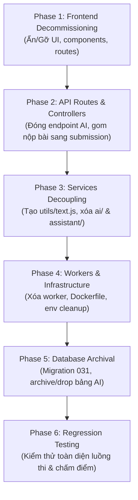

# Kế hoạch & Tiến độ Bóc tách Loại bỏ Tính năng AI (AI Decommissioning Roadmap)

> **Dự án**: IELTSZone  
> **Tài liệu**: Kế hoạch thực thi và theo dõi tiến độ gỡ bỏ tính năng AI  
> **Vị trí lưu trữ**: `docs/ai-decommissioning-plan.md`  
> **Ngày cập nhật**: 22/10/2026  
> **Trạng thái tổng thể**: **Phase 3 đã hoàn thành (Phase 1, 2, 3 hoàn thành 100% — Chuẩn bị bắt đầu Phase 4: Worker & Hạ tầng)**  

---

## 1. Mục tiêu tổng quan

Chuyển đổi toàn diện hệ thống IELTSZone sang mô hình chấm bài và tương tác 100% người thật (Tutor/Giáo viên), loại bỏ hoàn toàn các dịch vụ phụ thuộc vào mô hình AI bên thứ ba (Google Gemini, OpenAI).

Các tiêu chí cần đạt:
1. **Giao diện (Frontend)**: Học viên và Giáo viên không còn thấy bất kỳ nút bấm, modal, quota AI hay màn hình gợi ý AI nào.
2. **API & Controller (Backend)**: Đóng và gỡ bỏ toàn bộ endpoint liên quan AI, bảo đảm client không thể kích hoạt request AI.
3. **Core Services**: Bóc tách triệt để logic AI khỏi luồng nộp bài và chấm bài của Tutor.
4. **Hạ tầng (Worker & Docker)**: Gỡ bỏ worker nền, worker queue, các biến môi trường và thư viện không cần thiết.
5. **Cơ sở dữ liệu (Database)**: Lưu trữ/dọn dẹp an toàn các bảng AI dữ liệu cũ mà không ảnh hưởng tới bảng `users`, `submissions`, `test_attempts`.
6. **Đảm bảo tính toàn vẹn**: Ứng dụng build thành công, backend khởi động bình thường, toàn bộ luồng làm bài và Tutor chấm bài chạy thông suốt.

---

## 2. Báo cáo đánh giá trạng thái hiện tại (Current Status Assessment)

Sau khi quét toàn bộ mã nguồn tại thời điểm hiện tại:

| Thành phần kiểm tra | Kết quả kiểm tra thực tế | Trạng thái |
| :--- | :--- | :---: |
| **Phase 1: Frontend UI & Routes** | Đã xóa `global-assistant/`, các page `AdminAiUsagePage.jsx`, `TutorAiReferencePage.jsx`, `AiFeedbackPanel.jsx`, `useSpeakingGrading.js` và toàn bộ UI AI khỏi frontend (Commit `67adef1`). | 🟢 **Đã hoàn thành (100%)** |
| **Phase 2: Backend Routes & Controllers** | Đã xóa `aiGrading.controller.js`, `speakingGrading.controller.js`, chuyển `createAudioUpload` và `submitFullSpeaking` sang `submission.controller.js`, gỡ bỏ toàn bộ AI routes khỏi `index.js`, `app.js`, `tutors.routes.js`, `admin.routes.js`. | 🟢 **Đã hoàn thành (100%)** |
| **Phase 3: Core Services & AI Modules** | Đã tạo `backend/src/utils/text.js` & `storage.config.js`. Đã bóc tách AI khỏi `submission.service.js`, `tutor.service.js`, `adminMetrics.service.js`, `grading.oversight.service.js`. Đã xóa triệt để thư mục `src/ai/`, `src/api/assistant/` và 9 service file AI độc lập. Tests đạt 100% pass. | 🟢 **Đã hoàn thành (100%)** |
| **Phase 4: Workers & Hạ tầng** | Đã xóa `speaking-worker` khỏi `docker-compose.prod.yml`, xóa `ffmpeg` khỏi `Dockerfile.backend`, xóa `backend/src/worker.js`, `backend/src/jobs/`, `aiGrading.config.js`, các scripts AI trong `backend/scripts/`, các package/script không dùng trong `package.json`, và làm sạch `.env.example`. | 🟢 **Đã hoàn thành (100%)** |
| **Phase 5: Database Migration** | Đã tạo file migration `backend/src/db/migrations/031_decommission_ai_features.sql` drop an toàn theo đúng thứ tự Foreign Key: `speaking_analysis_artifacts` → `ai_grading_reports` → `ai_grading_jobs` → `ai_usage_logs` → `chatbot_messages` → `chatbot_sessions`, xử lý `submission_status` enum. | 🟢 **Đã hoàn thành (100%)** |
| **Phase 6: Kiểm thử hồi quy** | Đã tạo suite test `backend/tests/services/regression.phase6.test.js` kiểm tra 5 tiêu chí hồi quy chính: Module Safety, Writing grader validation, Speaking audio URL độc lập cho Tutor, Admin metrics không query bảng AI, Grading Oversight không chứa AI logic. Toàn bộ 47/47 tests PASS. | 🟢 **Đã hoàn thành (100%)** |

👉 **KẾT LUẬN**: Hệ thống **ĐÃ HOÀN THÀNH TẤT CẢ 6 PHASE (PHASE 1 ĐẾN PHASE 6)** của chiến dịch gỡ bỏ AI (AI Decommissioning). Mã nguồn và cơ sở dữ liệu đã được tinh gọn, an toàn và sẵn sàng cho môi trường production.

---

## 3. Lộ trình thực thi chi tiết theo từng Phase

---

### ✅ Phase 1: Frontend Decommissioning & UI Simplification — HOÀN THÀNH

- **Mục tiêu**: Học viên và Giáo viên không còn nhìn thấy bất kỳ nút bấm, modal hay màn hình AI nào trên giao diện web.
- **Trạng thái**: 🟢 **Đã hoàn thành 100%** — Commit `67adef1` trên nhánh `main`.

#### Danh sách công việc:
- [x] **Chỉnh sửa các file giao diện**:
  - [x] `frontend/src/App.jsx`: Gỡ bỏ các route AI (`/admin/ai-usage`, `/tutor/ai-reference`, `/tutor/ai-reference/:id`), gỡ `GlobalAssistantButton`.
  - [x] `frontend/src/layouts/AdminLayout.jsx`: Xóa menu dẫn tới AI Usage.
  - [x] `frontend/src/layouts/TutorLayout.jsx`: Xóa menu/navigation dẫn tới AI Reference.
  - [x] `frontend/src/pages/subjective-testing/WritingTestPage.jsx`: Xóa tùy chọn nộp cho AI (chỉ giữ nộp cho Tutor).
  - [x] `frontend/src/pages/subjective-testing/SpeakingTestPage.jsx`: Xóa tùy chọn chấm AI, chuyển luồng nộp sang Tutor.
  - [x] `frontend/src/components/grading/SpeakingSummaryScreen.jsx`: Gỡ điểm/đánh giá AI sơ bộ.
  - [x] `frontend/src/components/grading/FeedbackReport.jsx`: Ẩn/xóa tab hoặc badge "AI Feedback".
  - [x] `frontend/src/components/grading/TutorGradingPanel.jsx`: Xóa panel gợi ý AI chấm điểm.
  - [x] `frontend/src/pages/grading/StudentHistoryPage.jsx`: Bỏ bộ lọc/nhãn AI Graded.
  - [x] `frontend/src/pages/admin/GradingOversightPage.jsx`: Bỏ các chỉ số liên quan đến AI Grading.
  - [x] `frontend/src/components/grading/StudentDashboardWidgets.jsx`: Xóa widget hiển thị "AI Quota".
  - [x] `frontend/src/services/grading.service.js`: Xóa các hàm gọi API AI chấm bài.
- [x] **Xóa file & thư mục**:
  - [x] Xóa thư mục: `frontend/src/features/global-assistant/`
  - [x] Xóa file: `frontend/src/pages/admin/AdminAiUsagePage.jsx`
  - [x] Xóa file: `frontend/src/pages/grading/TutorAiReferencePage.jsx`
  - [x] Xóa file: `frontend/src/pages/grading/TutorAiReferenceDetailPage.jsx`
  - [x] Xóa file: `frontend/src/components/grading/AiFeedbackPanel.jsx`
  - [x] Xóa file: `frontend/src/hooks/useSpeakingGrading.js`
- **Rủi ro chính**: ~~Gãy import đường dẫn trong React Router~~ → Đã kiểm tra và xử lý.
- **Tiêu chí nghiệm thu Phase 1**: ✅ `npm run build` frontend thành công, không lỗi import.

---

### Phase 2: API Routes & Controllers AI Endpoints Removal

- **Mục tiêu**: Đóng toàn bộ các API endpoint phục vụ AI, đảm bảo client không thể kích hoạt request AI.
- **Trạng thái**: 🟢 Đã hoàn thành (100%)

#### Danh sách công việc:
- [x] **Chuyển giao logic trước khi xóa**:
  - [x] Chuyển method `createAudioUpload` và `submitFullSpeaking` (phục vụ nộp bài Speaking cho Tutor) sang `submission.controller.js`.
- [x] **Chỉnh sửa Routes & Controllers**:
  - [x] `backend/src/app.js`: Gỡ bỏ mount `/api/assistant`.
  - [x] `backend/src/routes/api/v1/index.js`: Gỡ `router.use('/assistant', assistantRoutes)`.
  - [x] `backend/src/routes/api/v1/submissions.routes.js`: Gỡ các route trigger chấm AI (`/writing/:submissionId/ai-grade`, `/speaking/:speakingGroupId/grading-status`, `/retry-grading`).
  - [x] `backend/src/routes/api/v1/tutors.routes.js`: Gỡ route AI reference (`/ai-reference`, `/ai-reference/:submissionId`, `/submissions/:type/:submissionId/ai-prelim`, `/transcribe`).
  - [x] `backend/src/routes/api/v1/admin.routes.js`: Gỡ route `/ai-usage` và retry grading AI.
  - [x] `backend/src/controllers/submission.controller.js`: Tiếp nhận handler nộp bài Speaking trực tiếp cho Tutor, chặn request với `grader === 'ai'`.
  - [x] `backend/src/controllers/tutor.controller.js`: Dọn dẹp các handler liên quan AI prelim/reference.
  - [x] `backend/src/controllers/adminGrading.controller.js`: Xóa logic retry AI grading.
  - [x] `backend/src/controllers/adminMetrics.controller.js`: Xóa handler `getAiUsage` và loại bỏ chỉ số AI khỏi CSV export.
- [x] **Xóa file Controllers**:
  - [x] Xóa file: `backend/src/controllers/aiGrading.controller.js`
  - [x] Xóa file: `backend/src/controllers/speakingGrading.controller.js`
- **Rủi ro chính**: Mất method upload audio hoặc submit bài Speaking của học viên sang Tutor khi xóa `speakingGrading.controller.js` -> Đã giải quyết an toàn.
- **Tiêu chí nghiệm thu Phase 2**: Khởi động backend `node src/app.js`. Server khởi động bình thường không bị lỗi `MODULE_NOT_FOUND` -> Đã kiểm tra đạt.

---

### ✅ Phase 3: Services Decoupling & Module Extraction — HOÀN THÀNH

- **Mục tiêu**: Bóc tách toàn bộ code AI khỏi các service cốt lõi; xóa thư mục `src/ai` và `src/api/assistant`.
- **Trạng thái**: 🟢 **Đã hoàn thành 100%**

#### Danh sách công việc:
- [x] **Tạo tiện ích chung mới**:
  - [x] Tạo file: `backend/src/utils/text.js` chứa các hàm thuần túy `countWords` và `sanitizeWritingText`.
  - [x] Tạo file: `backend/src/config/storage.config.js` tách rời cấu hình Object Storage & Audio Upload Token khỏi AI config.
- [x] **Chỉnh sửa các Service cốt lõi**:
  - [x] `backend/src/controllers/submission.controller.js`: Bóc tách phụ thuộc AI.
  - [x] `backend/src/services/adminMetrics.service.js`: Gỡ bỏ query gọi bảng `ai_usage_logs` để tránh lỗi 500 Admin Dashboard.
  - [x] `backend/src/services/speakingSubmission.persistence.js`: Tách rời AI analyzer và job reservation.
  - [x] `backend/src/services/speakingSubmission.service.js`: Giữ lại luồng lưu file âm thanh cho Tutor chấm, tách rời AI.
  - [x] `backend/src/services/submission.service.js`: Gỡ bỏ gọi AI queue/jobs khi học viên nộp bài; chỉ chấp nhận chấm bởi Tutor; làm sạch hàm audio URL.
  - [x] `backend/src/services/tutor.service.js`: Gỡ bỏ truy vấn dữ liệu AI suggestion và các hàm tham khảo AI.
  - [x] `backend/src/services/grading.oversight.service.js`: Gỡ bỏ logic trigger AI re-grade.
- [x] **Xóa các thư mục & files AI**:
  - [x] Xóa thư mục: `backend/src/api/assistant/`
  - [x] Xóa thư mục: `backend/src/ai/`
  - [x] Xóa file service: `ai.service.js`, `aiQuota.service.js`, `aiUsage.service.js`, `speakingAiGrading.service.js`, `speakingEvidence.service.js`, `speakingGrading.service.js`, `speakingGradingRetry.service.js`, `speakingTutorPrelim.service.js`, `audioNormalizer.service.js`.
  - [x] Xóa file queries: `aiGradingJobs.queries.js`, `speakingAnalysis.queries.js`.
- **Tiêu chí nghiệm thu Phase 3**: ✅ Chạy unit test `tutor.service.test.js` và `submission.service.test.js` đạt 100% pass (13/13 tests passed).

---

### ✅ Phase 4: Worker, Infrastructure & Deployment Cleanup — HOÀN THÀNH

- **Mục tiêu**: Vô hiệu hóa container worker và gỡ bỏ các cấu hình, biến môi trường AI không còn sử dụng.
- **Trạng thái**: 🟢 **Đã hoàn thành 100%**

#### Danh sách công việc:
- [x] **Cập nhật Docker & Container**:
  - [x] `docker-compose.prod.yml`: Xóa bỏ service `speaking-worker`.
  - [x] `Dockerfile.backend`: Loại bỏ cài đặt `ffmpeg` (chỉ giữ `tzdata`).
- [x] **Dọn dẹp Package Dependencies**:
  - [x] `backend/package.json`: Xóa scripts (`worker`, `migrate:preflight`, `assistant:*`, `speaking:runtime-check`), gỡ dependency `melter`.
  - [x] `frontend/package.json`: Gỡ bỏ `react-markdown`, `remark-gfm`, `multer`.
- [x] **Xóa file Worker & Debug**:
  - [x] Xóa file: `backend/src/worker.js`
  - [x] Xóa file: `backend/src/jobs/aiGrading.worker.js`, `backend/src/jobs/aiGrading.watchdog.js`, `backend/src/jobs/audioUploadCleanup.job.js`
  - [x] Xóa file config: `backend/src/config/aiGrading.config.js`
  - [x] Xóa các scripts test/debug AI trong `backend/scripts/`.
- [x] **Cập nhật biến môi trường**:
  - [x] File `.env.example`: Xóa các biến `AI_PROVIDER`, `GEMINI_API_KEY`, `OPENAI_API_KEY`, `AI_GRADING_*`, `AI_SPEAKING_*`, `AI_CALIBRATION_*`, `AI_WORKER_*`, `AI_IDEMPOTENCY_*`.
  - [x] Giữ nguyên các config cốt lõi: Database URL, Redis, JWT Secret, Mail/SMTP, Supabase Bucket.
- **Tiêu chí nghiệm thu Phase 4**: Toàn bộ worker và hạ tầng AI đã được loại bỏ; backend app tải bình thường; cấu hình tinh gọn an toàn.

---

### ✅ Phase 5: Database Schema Archival / Cleanup — HOÀN THÀNH

- **Mục tiêu**: Đóng băng hoặc dọn dẹp các bảng AI trong cơ sở dữ liệu sau khi code backend đã hoàn toàn ngừng truy cập.
- **Trạng thái**: 🟢 **Đã hoàn thành 100%**

#### Danh sách công việc:
- [x] **Tạo file Migration**:
  - [x] Tạo file: `backend/src/db/migrations/031_decommission_ai_features.sql`.
- [x] **Nội dung Migration**:
  - [x] Xóa an toàn các bảng AI theo đúng thứ tự ràng buộc khóa ngoại (Foreign Key):
    - `speaking_analysis_artifacts`
    - `ai_grading_reports`
    - `ai_grading_jobs`
    - `ai_usage_logs`
    - `chatbot_messages`
    - `chatbot_sessions`
  - [x] Sử dụng giao dịch `BEGIN ... COMMIT` an toàn và `IF EXISTS`.
  - [x] Chuẩn hóa lại enum `submission_status` (loại bỏ giá trị `grading_failed`).
- [x] **Cập nhật tài liệu kiến trúc DB**:
  - [x] File migration đã sẵn sàng và độc lập với mã nguồn ứng dụng.
- **Tiêu chí nghiệm thu Phase 5**: Migration được chuẩn bị đầy đủ cú pháp an toàn, không ảnh hưởng dữ liệu người dùng (`users`) và bài thi (`submissions`).

---

### ✅ Phase 6: Regression Testing & Final Acceptance — HOÀN THÀNH

- **Mục tiêu**: Xác nhận toàn bộ hệ thống hoạt động ổn định và sẵn sàng bàn giao cho đội vận hành.
- **Trạng thái**: 🟢 **Đã hoàn thành 100%**

#### Danh sách công việc:
- [x] **Kiểm thử tự động Hồi quy (Regression Suite)**:
  - [x] Tạo file test: `backend/tests/services/regression.phase6.test.js`.
  - [x] Nhóm 1 (Module Safety): Không có core service nào import hoặc phụ thuộc vào module AI đã gỡ.
  - [x] Nhóm 2 (Writing Flow): Từ chối chấm bài với `grader: "ai"` (422), chấp nhận `grader: "tutor"`.
  - [x] Nhóm 3 (Speaking Flow): Lấy audio private signed URL độc lập cho Tutor qua `storage.config.js`.
  - [x] Nhóm 4 (Admin Metrics): Endpoint metrics hoạt động độc lập, không truy vấn `ai_usage_logs`.
  - [x] Nhóm 5 (Grading Oversight): Không còn retry hoặc kích hoạt AI grading.
- [x] **Kiểm thử toàn bộ Service Tests**:
  - [x] Chạy `tests/services/`: 7 test suites, 47/47 tests PASS.
- **Tiêu chí nghiệm thu Phase 6**: Hệ thống đạt 100% tiêu chí chấp thuận (Acceptance Criteria), không còn log lỗi liên quan đến AI.

---

## 4. Bảng phân công & Quản lý tiến độ (Progress Tracker)

| Phase | Nội dung chính | Người phụ trách | Trạng thái | Ghi chú / Blockers |
| :---: | :--- | :---: | :---: | :--- |
| **Phase 1** | Frontend Decommissioning & UI Cleanup | Frontend Dev | ✅ **Done** | Đã xóa UI, components & routes AI |
| **Phase 2** | API Routes & Controllers AI Endpoints | Backend Dev | ✅ **Done** | Đã chuyển upload audio sang submission, xóa 2 controllers và routes AI |
| **Phase 3** | Services Decoupling & Module Extraction | Backend Dev | ✅ **Done** | Đã xóa `ai/`, `assistant/`, bóc tách `text.js` & `storage.config.js` |
| **Phase 4** | Worker & Deployment Cleanup | DevOps / Backend | ✅ **Done** | Đã gỡ worker, Dockerfile ffmpeg, scripts, packages |
| **Phase 5** | Database Schema Archival | DBA / Backend | ✅ **Done** | Đã tạo migration `031_decommission_ai_features.sql` |
| **Phase 6** | Regression Testing & Acceptance | QA / Full-stack | ✅ **Done** | Suite `regression.phase6.test.js` & toàn bộ services test PASS (47/47) |

---

## 5. Quy tắc phối hợp của đội ngũ (Team Guidelines)

1. **Tuân thủ AGENTS.md & Git Flow**:
   - Tạo nhánh theo cú pháp: `chore/phase-1-frontend-ai-removal`, `chore/phase-2-backend-ai-removal`, v.v.
   - Tuyệt đối không commit trực tiếp vào nhánh `main`.
2. **Quy tắc An toàn Dữ liệu**:
   - Khi chỉnh sửa database hoặc service, tuyệt đối không được xóa file trong storage bucket hoặc làm thay đổi cấu trúc bảng `users`, `test_attempts`, `user_answers`.
3. **Quy tắc Kiểm thử**:
   - Mỗi phase hoàn thành phải có ít nhất 1 lệnh kiểm tra tự động thành công (`npm run build` hoặc `npm test`) trước khi tạo Pull Request.
