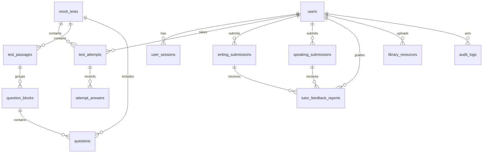

# IELTSZone — Đặc tả database bàn giao đối tác (không có AI)

> Đặc tả nghiệp vụ và schema đích để đối tác xây dựng lại database IELTSZone sau khi loại bỏ AI. Đối tác cần xác nhận các mục “cần thống nhất” ở cuối tài liệu trước khi triển khai migration.
>
> Cập nhật: 27/10/2026

## 1. Phạm vi và số lượng bảng

Sau khi chỉ lọc các bảng AI khỏi danh sách trong SDD, còn **25 bảng không phải AI**. Danh sách dưới đây giữ đủ các bảng nghiệp vụ và vận hành, kể cả các bảng legacy/trùng chức năng như `question_answers`, `attempt_answers`, `tutor_feedback_reports` và `tutor_grading_reports`. Không tự ý xóa các bảng đó khỏi gói bàn giao.

### Các bảng nghiệp vụ nên giữ

| Nhóm | Bảng |
|---|---|
| Tài khoản và bảo mật | `users`, `email_verification_tokens`, `password_reset_tokens`, `password_history`, `oauth_accounts`, `user_sessions` |
| Nội dung thi | `mock_tests`, `test_passages`, `question_blocks`, `questions` |
| Lịch sử làm bài | `test_attempts`, `question_answers`, `attempt_answers`, `speaking_attempts`, `speaking_attempt_answers` |
| Bài tự luận và Tutor | `writing_submissions`, `speaking_submissions`, `tutor_feedback_reports`, `tutor_grading_reports`, `tutor_student_notes` |
| Vận hành nội dung | `library_resources`, `contact_submissions`, `audit_logs`, `platform_metrics_snapshots`, `schema_migrations` |

**Tổng: 25 bảng.** Đáp án Reading/Listening được lưu ở `question_answers` và/hoặc `attempt_answers`; cần giữ đầy đủ cả hai theo schema hiện tại để chấm, lưu lịch sử và đối chiếu dữ liệu.

### Bảng/tên trong tài liệu cũ cần bỏ hoặc xác minh

`chatbot_sessions`, `chatbot_messages`, `ai_explain_requests`, `ai_feedback_reports`, `ai_grading_reports`, `ai_grading_jobs`, `ai_usage_logs`, `speaking_analysis_artifacts` là AI-only và không thuộc schema đích. Migration `031_decommission_ai_features.sql` hiện chỉ drop sáu bảng: `speaking_analysis_artifacts`, `ai_grading_reports`, `ai_grading_jobs`, `ai_usage_logs`, `chatbot_messages`, `chatbot_sessions`. Nó chưa xử lý `ai_explain_requests` và `ai_feedback_reports` nếu các bảng này từng được tạo.

Hai bảng `platform_metrics_snapshots` và `schema_migrations` có trong SDD nhưng không có migration tạo bảng trong thư mục hiện có. Chúng vẫn được giữ trong danh sách 25 bảng vì yêu cầu là chỉ lọc AI; đối tác cần đối chiếu database đang chạy và triển khai chúng nếu thuộc phạm vi sản phẩm. Bỏ hai cột AI `ai_calls_total`, `ai_tokens_total` khỏi `platform_metrics_snapshots`. Migration runner hiện tham chiếu `applied_migrations`; giữ bảng đó riêng nếu cần cho hạ tầng migration, không thay thế bảng `schema_migrations` nghiệp vụ trong SDD khi chưa thống nhất.

## 2. Tóm tắt bàn giao cho đối tác

Đối tác triển khai PostgreSQL với **25 bảng không phải AI** trong danh mục và mô tả chi tiết bên dưới. Các bảng được đánh dấu legacy vẫn phải được mô tả/đối chiếu; không được tự ý gộp hoặc bỏ. Không tạo các bảng AI đã liệt kê ở phần trên.

Các yêu cầu bắt buộc:

- Dùng UUID làm khóa chính; khai báo đầy đủ PK, FK, UNIQUE, CHECK, NOT NULL, DEFAULT và hành vi `ON DELETE`.
- Dùng `TIMESTAMPTZ` cho thời điểm; giữ các trường soft-delete `deleted_at` ở submission/feedback theo thiết kế.
- Đảm bảo một submission Writing/Speaking chỉ có feedback Tutor active phù hợp; mỗi feedback gắn đúng một loại submission.
- Bảo toàn cấu trúc test: `mock_tests` → `test_passages` → `question_blocks` → `questions`; câu hỏi cũng tham chiếu trực tiếp `mock_tests`.
- Bảo toàn đáp án Reading/Listening của từng lượt thi trong cả `question_answers` và `attempt_answers` theo cấu trúc dữ liệu hiện được mô tả; bảo toàn câu Speaking trong `speaking_attempt_answers`.
- Không lưu provider/model/prompt/token hay kết quả chấm AI. Việc chấm điểm tự luận là do Tutor ghi vào `tutor_feedback_reports`.
- Bàn giao kèm ERD, DDL tạo schema, migration dữ liệu cần thiết, và danh sách index/constraint. Đối tác không được chạy lệnh xóa dữ liệu production trước khi có bản sao lưu và xác nhận mapping dữ liệu.

## 3. Quy ước

- Các khóa chính dùng `UUID`, thường có mặc định `gen_random_uuid()`.
- Thời gian dùng `TIMESTAMPTZ`; trường có thể vắng mặt được ghi `NULL`.
- `FK` thể hiện bảng được tham chiếu; hành vi xóa theo migration hiện hành (CASCADE / SET NULL) nên được giữ lại khi tái tạo.
- `JSONB` chỉ dùng cho cấu trúc nội dung/câu trả lời, không giữ payload nhà cung cấp AI.

## 4. Schema 25 bảng bàn giao

### 3.1 Tài khoản và bảo mật

#### `users`

Tài khoản, hồ sơ, vai trò, trạng thái, mục tiêu học tập và trạng thái bảo mật đăng nhập.

| Cột | Kiểu | Ràng buộc / ghi chú |
|---|---|---|
| `id` | UUID | PK |
| `email` | VARCHAR(255) | NOT NULL, UNIQUE; email đăng nhập đã chuẩn hóa |
| `password_hash` | VARCHAR(255) | NULL với tài khoản OAuth-only |
| `full_name` | VARCHAR(100) | NOT NULL |
| `avatar_url` | VARCHAR(255) | NULL |
| `role` | `user_role` | NOT NULL, mặc định `student` |
| `status` | `account_status` | NOT NULL, mặc định `pending` |
| `target_band_score` | NUMERIC(3,1) | NULL; 0–9, bước 0.5 |
| `target_test_date` | DATE | NULL |
| `email_verified_at` | TIMESTAMPTZ | NULL |
| `must_change_password` | BOOLEAN | NOT NULL, mặc định FALSE |
| `failed_login_attempts` | INTEGER | NOT NULL, mặc định 0 |
| `locked_until` | TIMESTAMPTZ | NULL |
| `last_login_at` | TIMESTAMPTZ | NULL |
| `created_at`, `updated_at` | TIMESTAMPTZ | NOT NULL; `updated_at` tự cập nhật |

#### `email_verification_tokens`

| Cột | Kiểu | Ràng buộc / ghi chú |
|---|---|---|
| `id` | UUID | PK |
| `user_id` | UUID | FK → `users.id`, NOT NULL |
| `token_hash` | TEXT | NOT NULL, UNIQUE; không lưu token thô |
| `expires_at` | TIMESTAMPTZ | NOT NULL |
| `used_at` | TIMESTAMPTZ | NULL |
| `created_at` | TIMESTAMPTZ | NOT NULL |

#### `password_reset_tokens`

| Cột | Kiểu | Ràng buộc / ghi chú |
|---|---|---|
| `id` | UUID | PK |
| `user_id` | UUID | FK → `users.id`, NOT NULL |
| `token_hash` | TEXT | NOT NULL, UNIQUE |
| `expires_at` | TIMESTAMPTZ | NOT NULL |
| `used_at` | TIMESTAMPTZ | NULL |
| `requested_from` | INET | NULL; IP yêu cầu |
| `created_at` | TIMESTAMPTZ | NOT NULL |

#### `password_history`

| Cột | Kiểu | Ràng buộc / ghi chú |
|---|---|---|
| `id` | UUID | PK |
| `user_id` | UUID | FK → `users.id`, NOT NULL |
| `hash` | TEXT | NOT NULL; hash mật khẩu cũ |
| `reason` | `password_change_reason` | NOT NULL |
| `changed_from_ip` | INET | NULL |
| `created_at` | TIMESTAMPTZ | NOT NULL |

#### `oauth_accounts`

| Cột | Kiểu | Ràng buộc / ghi chú |
|---|---|---|
| `id` | UUID | PK |
| `user_id` | UUID | FK → `users.id`, NOT NULL |
| `provider` | `oauth_provider` | NOT NULL; chỉ định danh nhà cung cấp đăng nhập |
| `provider_user_id` | VARCHAR | NOT NULL |
| `provider_email` | VARCHAR | NULL |
| `access_token`, `refresh_token` | TEXT | NULL; chỉ lưu nếu tích hợp thực sự cần |
| `token_expires_at` | TIMESTAMPTZ | NULL |
| `raw_profile` | JSONB | NULL; nên chỉ giữ các thuộc tính OAuth cần thiết |
| `linked_at`, `updated_at` | TIMESTAMPTZ | NOT NULL |

#### `user_sessions`

| Cột | Kiểu | Ràng buộc / ghi chú |
|---|---|---|
| `id` | UUID | PK |
| `user_id` | UUID | FK → `users.id`, NOT NULL |
| `session_token` | TEXT | NOT NULL, UNIQUE; ưu tiên lưu hash/định danh không thể dùng lại trực tiếp |
| `ip_address` | INET | NULL |
| `user_agent` | TEXT | NULL |
| `is_oauth` | BOOLEAN | NOT NULL, mặc định FALSE |
| `oauth_provider` | `oauth_provider` | NULL |
| `last_active_at`, `expires_at` | TIMESTAMPTZ | NOT NULL |
| `revoked_at` | TIMESTAMPTZ | NULL |
| `created_at`, `updated_at` | TIMESTAMPTZ | NOT NULL |

### 3.2 Đề thi và nội dung câu hỏi

#### `mock_tests`

| Cột | Kiểu | Ràng buộc / ghi chú |
|---|---|---|
| `id` | UUID | PK |
| `title` | VARCHAR(500) | NOT NULL |
| `description` | TEXT | NULL |
| `skill` | `skill_type` | NOT NULL: reading/listening/writing/speaking |
| `difficulty` | `difficulty` | NOT NULL, mặc định `intermediate` |
| `duration_minutes` | INTEGER | NULL |
| `is_published` | BOOLEAN | NOT NULL, mặc định FALSE |
| `publish_at` | TIMESTAMPTZ | NULL |
| `created_by` | UUID | FK → `users.id`, NULL khi user bị xóa |
| `review_status` | `review_status` | NOT NULL nếu đã thêm bởi migration review |
| `audio_url` | TEXT | NULL; giữ cho audio Listening được quản lý cùng test |
| `created_at`, `updated_at` | TIMESTAMPTZ | NOT NULL |

#### `test_passages`

| Cột | Kiểu | Ràng buộc / ghi chú |
|---|---|---|
| `id` | UUID | PK |
| `test_id` | UUID | FK → `mock_tests.id` ON DELETE CASCADE, NOT NULL |
| `passage_number` | INTEGER | NOT NULL; UNIQUE cùng `test_id` |
| `title` | VARCHAR(500) | NULL |
| `instruction` | TEXT | NULL |
| `content` | TEXT | NULL |
| `created_at`, `updated_at` | TIMESTAMPTZ | NOT NULL |

#### `question_blocks`

| Cột | Kiểu | Ràng buộc / ghi chú |
|---|---|---|
| `id` | UUID | PK |
| `passage_id` | UUID | FK → `test_passages.id` ON DELETE CASCADE, NOT NULL |
| `block_order` | INTEGER | NOT NULL |
| `question_type` | VARCHAR(100) | NOT NULL |
| `question_range` | VARCHAR(50) | NULL |
| `content` | TEXT | NULL; hướng dẫn/nội dung chung của nhóm |
| `created_at`, `updated_at` | TIMESTAMPTZ | NOT NULL |

#### `questions`

| Cột | Kiểu | Ràng buộc / ghi chú |
|---|---|---|
| `id` | UUID | PK |
| `test_id` | UUID | FK → `mock_tests.id` ON DELETE CASCADE, NOT NULL |
| `block_id` | UUID | FK → `question_blocks.id` ON DELETE CASCADE, NULL |
| `question_order` | INTEGER | NOT NULL; UNIQUE cùng `test_id` |
| `question_text` | TEXT | NULL |
| `options` | JSONB | NULL |
| `correct_answer` | TEXT | NULL; đáp án chuẩn dạng đơn |
| `correct_answers` | JSONB | NULL; các đáp án chấp nhận được |
| `explanation` | TEXT | NULL; lời giải do tác giả nội dung soạn |
| `created_at`, `updated_at` | TIMESTAMPTZ | NOT NULL |

### 3.3 Lịch sử làm bài

#### `test_attempts`

| Cột | Kiểu | Ràng buộc / ghi chú |
|---|---|---|
| `id` | UUID | PK |
| `user_id` | UUID | FK → `users.id` ON DELETE CASCADE, NOT NULL |
| `test_id` | UUID | FK → `mock_tests.id` ON DELETE CASCADE, NOT NULL |
| `mode` | `test_mode` | NOT NULL, mặc định `timed` |
| `started_at`, `created_at` | TIMESTAMPTZ | NOT NULL |
| `submitted_at` | TIMESTAMPTZ | NULL |
| `status` | VARCHAR(20) | NOT NULL, mặc định `completed` theo migration 014 |
| `raw_score` | INTEGER | NOT NULL, mặc định 0 |
| `total_questions` | INTEGER | NOT NULL, mặc định 0 |
| `band_score` | NUMERIC(3,1) | NULL; 0–9 |
| `time_spent` | INTEGER | NULL; giây |
| `practice_mode` | BOOLEAN | NOT NULL, mặc định FALSE |

#### `question_answers` — câu trả lời và kết quả chấm Reading/Listening

`id UUID PK`; `attempt_id UUID FK → test_attempts.id ON DELETE CASCADE NOT NULL`; `question_id UUID FK → questions.id ON DELETE CASCADE NOT NULL`; `given_answer TEXT`; `is_correct BOOLEAN`; `created_at TIMESTAMPTZ NOT NULL`. UNIQUE (`attempt_id`, `question_id`).

#### `attempt_answers` — câu trả lời khách quan với snapshot cho từng lượt thi

`id UUID PK`; `attempt_id UUID FK → test_attempts.id ON DELETE CASCADE NOT NULL`; `question_id UUID FK → questions.id ON DELETE CASCADE NOT NULL`; `question_order INTEGER NOT NULL`; `user_answer TEXT`; `is_correct BOOLEAN NOT NULL`; `correct_answer TEXT`.

Đặt UNIQUE (`attempt_id`, `question_id`) để mỗi câu chỉ có một đáp án trong một lượt làm bài.

Hai bảng đáp án cùng tồn tại trong tài liệu/schema dự án và được giữ trong phạm vi bàn giao. Đối tác cần đảm bảo dữ liệu được lưu/đọc nhất quán giữa các luồng hiện dùng từng bảng; việc hợp nhất chúng là quyết định thay đổi phạm vi, cần được xác nhận riêng.

#### `speaking_attempts`

`id UUID PK`; `user_id UUID FK → users.id NOT NULL`; `test_id UUID FK → mock_tests.id NULL`; `status VARCHAR NOT NULL`; `submitted_at TIMESTAMPTZ NULL`; `created_at`, `updated_at TIMESTAMPTZ NOT NULL`.

Migration 015 từng tạo cột `grader grader_type`; **không đưa cột này vào schema bàn giao**. Luồng Speaking trong schema mới mặc định được Tutor xử lý.

#### `speaking_attempt_answers`

`id UUID PK`; `attempt_id UUID FK → speaking_attempts.id ON DELETE CASCADE NOT NULL`; `part_number SMALLINT NOT NULL`; `question_index SMALLINT NOT NULL`; `audio_url TEXT NOT NULL`; `temp_s3_key TEXT NULL`; `duration_seconds SMALLINT NULL`; `status VARCHAR NOT NULL`; `created_at TIMESTAMPTZ NOT NULL`.

### 3.4 Bài nộp Writing/Speaking và chấm bởi Tutor

#### `writing_submissions`

`id UUID PK`; `user_id UUID FK → users.id ON DELETE CASCADE NOT NULL`; `test_id UUID FK → mock_tests.id ON DELETE SET NULL NULL`; `task_number SMALLINT NULL (1,2)`; `prompt_text TEXT NULL`; `response_text TEXT NOT NULL`; `file_url TEXT NULL`; `status submission_status NOT NULL DEFAULT 'pending'`; `submitted_at`, `created_at TIMESTAMPTZ NOT NULL`; `assigned_tutor_id UUID FK → users.id ON DELETE SET NULL NULL`; `writing_group_id UUID NULL`; `word_count INTEGER NULL`; `overall_tutor_band NUMERIC(3,1) NULL`; `updated_at TIMESTAMPTZ NOT NULL`; `deleted_at TIMESTAMPTZ NULL`.

`grader`, `ai_status`, `overall_ai_band` là cột legacy AI/định tuyến; loại bỏ sau khi chuyển dữ liệu cần thiết. `tutor_status` cũng là trạng thái lặp với `status`; chỉ giữ nếu code còn dựa vào nó.

#### `speaking_submissions`

`id UUID PK`; `user_id UUID FK → users.id ON DELETE CASCADE NOT NULL`; `test_id UUID FK → mock_tests.id ON DELETE SET NULL NULL`; `part_number SMALLINT NULL (1,2,3)`; `prompt_text TEXT NULL`; `audio_url TEXT NULL`; `audio_storage_key TEXT NULL`; `transcript TEXT NULL`; `status submission_status NOT NULL DEFAULT 'pending'`; `submitted_at`, `created_at TIMESTAMPTZ NOT NULL`; `speaking_group_id UUID NOT NULL`; `assigned_tutor_id UUID FK → users.id ON DELETE SET NULL NULL`; `declared_audio_sha256 CHAR(64) NULL`; `audio_sha256 CHAR(64) NULL`; `audio_size_bytes BIGINT NULL`; `declared_duration_ms INTEGER NULL`; `source_prompt_id UUID NULL`; `prompt_snapshot_sha256 CHAR(64) NULL`; `assigned_tutor_at TIMESTAMPTZ NULL`; `updated_at TIMESTAMPTZ NOT NULL`; `deleted_at TIMESTAMPTZ NULL`.

Giữ metadata audio, checksum, nhóm bài và giao Tutor vì phục vụ nộp bài/chấm người thật. Bỏ `grader` sau khi chuyển dữ liệu; bỏ `transcript` chỉ nếu sản phẩm không còn chức năng lưu transcript người dùng/Tutor.

#### `tutor_feedback_reports` — bảng chấm Tutor đang được backend sử dụng

`id UUID PK`; `tutor_id UUID FK → users.id ON DELETE SET NULL NULL`; `writing_submission_id UUID FK → writing_submissions.id ON DELETE CASCADE NULL`; `speaking_submission_id UUID FK → speaking_submissions.id ON DELETE CASCADE NULL`; `task_number SMALLINT NULL`; `band_score NUMERIC(3,1) NULL`; `task_achievement_score`, `coherence_score`, `lexical_score`, `grammar_score`, `fluency_score`, `pronunciation_score NUMERIC(3,1) NULL`; `written_feedback TEXT NULL`; `audio_feedback_url TEXT NULL`; `created_at`, `updated_at TIMESTAMPTZ NOT NULL`; `deleted_at TIMESTAMPTZ NULL`.

Ràng buộc: đúng một trong `writing_submission_id` hoặc `speaking_submission_id` khác NULL; điểm nằm trong miền IELTS hợp lệ; unique một báo cáo active cho từng bài nộp (partial unique index theo `deleted_at IS NULL`).

#### `tutor_grading_reports` — báo cáo chấm Tutor đa hình

`id UUID PK`; `tutor_id UUID FK → users.id NULL`; `submission_id UUID NOT NULL`; `submission_type VARCHAR NOT NULL` (`writing` hoặc `speaking`); `band_score NUMERIC(3,1) NULL`; `task_achievement_score`, `coherence_score`, `lexical_score`, `grammar_score`, `fluency_score`, `pronunciation_score NUMERIC(3,1) NULL`; `written_feedback TEXT NULL`; `audio_feedback_url TEXT NULL`; `created_at`, `updated_at TIMESTAMPTZ NOT NULL`.

Giữ bảng này vì đây là bảng Tutor, không phải AI. Nó khác mô hình liên kết của `tutor_feedback_reports`; đối tác cần thể hiện cả hai và không gộp nếu chưa có quyết định nghiệp vụ.

#### `tutor_student_notes`

`id UUID PK`; `tutor_id UUID FK → users.id NOT NULL`; `student_id UUID FK → users.id NOT NULL`; `note TEXT NOT NULL`; `created_at`, `updated_at TIMESTAMPTZ NOT NULL`.

### 3.5 Thư viện, hỗ trợ và audit

#### `library_resources`

`id UUID PK`; `title VARCHAR NOT NULL`; `description TEXT NULL`; `resource_type resource_type NOT NULL`; `file_url TEXT NOT NULL`; `file_size_bytes BIGINT NULL`; `uploaded_by UUID FK → users.id ON DELETE SET NULL NULL`; `is_published BOOLEAN NOT NULL DEFAULT FALSE`; `review_status review_status NOT NULL`; `category VARCHAR(100) NULL`; `storage_cleanup_pending BOOLEAN NOT NULL DEFAULT FALSE`; `created_at`, `updated_at TIMESTAMPTZ NOT NULL`.

#### `contact_submissions`

`id UUID PK`; `name VARCHAR(255) NOT NULL`; `email VARCHAR(255) NOT NULL`; `subject VARCHAR(500) NOT NULL`; `message TEXT NOT NULL`; `status VARCHAR(50) NOT NULL DEFAULT 'pending'`; `reply_message TEXT NULL`; `admin_notes TEXT NULL`; `assigned_to_id UUID FK → users.id ON DELETE SET NULL NULL`; `resolved_at TIMESTAMPTZ NULL`; `created_at`, `updated_at TIMESTAMPTZ NOT NULL`.

#### `audit_logs`

`id UUID PK`; `actor_id UUID FK → users.id ON DELETE SET NULL NULL`; `action log_action NOT NULL`; `target_table VARCHAR NULL`; `target_id UUID NULL`; `old_value JSONB NULL`; `new_value JSONB NULL`; `ip_address INET NULL`; `created_at TIMESTAMPTZ NOT NULL`; `can_undo BOOLEAN NOT NULL DEFAULT FALSE`; `undone_at TIMESTAMPTZ NULL`; `undone_by UUID FK → users.id NULL`; `undo_log_id UUID FK → audit_logs.id NULL`.

#### `platform_metrics_snapshots` — snapshot chỉ số nền tảng không AI

`id UUID PK`; `snapshot_date DATE NOT NULL UNIQUE`; `total_users INTEGER NOT NULL`; `active_tests INTEGER NOT NULL`; `new_registrations INTEGER NOT NULL`; `created_at TIMESTAMPTZ NOT NULL`. Không đưa `ai_calls_total` hoặc `ai_tokens_total` vào schema không AI.

#### `schema_migrations` — lịch sử migration theo SDD

`version TEXT PK`; `checksum CHAR NOT NULL`; `applied_at TIMESTAMPTZ NOT NULL`. Đối chiếu với migration runner thực tế (`applied_migrations`) khi tích hợp; có thể cần cả hai với vai trò khác nhau.

## 5. Enum đích sau khi bỏ AI

| Enum | Giá trị ứng dụng nên giữ |
|---|---|
| `user_role` | `user`, `student`, `tutor`, `admin` (chuẩn hóa `user` nếu không còn dùng) |
| `account_status` | `pending`, `active`, `inactive`, `banned` |
| `password_change_reason` | `user_initiated`, `reset_via_email`, `forced_default`, `admin_reset` |
| `skill_type` | `reading`, `listening`, `writing`, `speaking` |
| `difficulty` | `beginner`, `intermediate`, `advanced` |
| `test_mode` | `timed`, `untimed` |
| `oauth_provider` | Các nhà cung cấp OAuth thực sự được bật trong ứng dụng |
| `resource_type` | `pdf`, `audio`, `video`, `other` |
| `review_status` | `pending`, `approved`, `rejected` |
| `submission_status` | `pending`, `tutor_graded`, `reviewed` (cộng trạng thái khác nếu code không AI còn dùng) |
| `log_action` | Các action audit hiện còn trong app; loại action AI khi có |

`grader_type ('ai','tutor')` không phù hợp với schema đích. Chuyển các bản ghi AI cũ theo chính sách lưu trữ, đặt bài còn hoạt động vào luồng Tutor khi đúng nghiệp vụ, sau đó loại enum/cột `grader`. Không giữ trạng thái `ai_graded` hoặc `grading_failed` chỉ để tương thích với pipeline đã xóa.

## 6. Việc cần xử lý khi chuyển từ database cũ

1. Sửa migration dọn AI để xử lý thêm `ai_explain_requests` và `ai_feedback_reports` nếu tồn tại; cân nhắc `DROP ... IF EXISTS` cho an toàn khi deploy nhiều môi trường.
2. Loại `grader_type`, cột `grader` trên Writing/Speaking và Speaking attempts, các cột AI (`ai_status`, `overall_ai_band`, `ai_*`) cùng enum trạng thái AI sau khi rà soát code và chuyển dữ liệu.
3. Giữ cả `tutor_feedback_reports` và `tutor_grading_reports` trong bản đối chiếu; xác minh service nào dùng từng bảng trước khi đề xuất hợp nhất.
4. Giữ cả `question_answers` và `attempt_answers` trong schema bàn giao; xác minh các luồng Reading/Listening ghi và đọc bảng nào để đảm bảo đáp án được chấm và lưu lịch sử chính xác.
5. Loại các trường thống kê AI khỏi dashboard snapshot; bản migration hiện tại không tạo bảng snapshot nên cần xác minh production.
6. Xác minh schema trực tiếp trên DB từng môi trường trước khi áp dụng migration; migration 031 hiện chỉ cập nhật schema khi được chạy, tài liệu này không chứng minh migration đã chạy production.

## 7. Quan hệ chính

